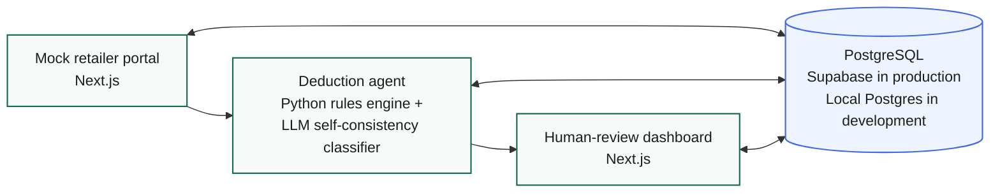
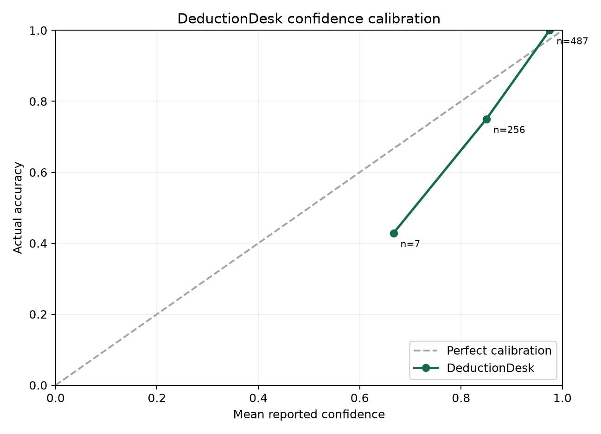

<div align="center">

# DeductionDesk

### AI-assisted deduction resolution for consumer packaged goods finance teams

[](https://deductiondesk-dashboard.vercel.app)
[](eval/reports/combined_summary.json)


</div>

## Contents

- [The problem](#the-problem)
- [Live applications](#live-applications)
- [Architecture](#architecture)
- [What this demonstrates](#what-this-demonstrates)
- [Results](#results)
- [Honest limitations](#honest-limitations)
- [How to run locally](#how-to-run-locally)
- [Tech stack and job alignment](#tech-stack-and-job-alignment)

## The problem

Consumer packaged goods companies routinely receive less money than they invoiced because retailers subtract shortages, damages, pricing differences, promotions, and compliance fees from payments. Finance teams then have to reconstruct what happened across purchase orders, invoices, delivery records, and retailer notes before deciding whether to accept each deduction or dispute it. **DeductionDesk turns that fragmented investigation into a traceable workflow:** deterministic cases are handled by policy rules, ambiguous cases are escalated to an AI classifier, and the highest-value uncertain decisions are presented to a human reviewer with the underlying evidence.

## Live applications

| Application | Link | Access |
|---|---|---|
| **Supplier portal** | [Open the mock retailer portal](https://deductiondesk-portal.vercel.app) | `supplier_demo` / `glimpse2026` |
| **Review dashboard** | [Open the human-review queue](https://deductiondesk-dashboard.vercel.app) | No login required |
| **GitHub repository** | [Placeholder repository link](https://github.com/your-username/deductiondesk) | Replace before publishing |

## Architecture



The portal is the retailer-facing source and dispute-filing surface. The agent gathers evidence, resolves deterministic cases with rules, and sends ambiguous cases through three independent LLM judgments. The dashboard exposes the remaining decisions to accounting reviewers. PostgreSQL is the shared system of record for evidence, decisions, reviews, disputes, and evaluation data.

## What this demonstrates

- **Rules-first routing** — 64.9% of cases resolve deterministically; only 35.1% are escalated to the LLM.
- **Self-consistency confidence** — confidence is the three-call agreement rate, not a model's self-reported certainty score.
- **Calibration as an evaluated property** — confidence is compared with actual accuracy by bucket and rendered as a reproducible chart.
- **Adversarial portal-drift testing** — three mutated API scenarios test whether integration changes are detected instead of silently corrupting decisions.
- **End-to-end dispute operations** — the system generates an evidence-backed packet, files it through the portal, updates deduction state, and preserves an audit trail.
- **Human-in-the-loop review** — unresolved cases are ranked by claimed amount and model uncertainty so reviewers see the largest financial exposure first.

### Confidence calibration



## Results

Final locked results for the 750-deduction evaluation set:

| Evaluation measure | Result | What it means |
|---|---:|---|
| Overall accuracy against ground truth | **90.93%** | 682 of 750 final verdicts matched the generated truth labels. |
| LLM-only accuracy | **74.14%** | The ambiguous subset remains materially harder than rules-resolved cases (**95.7%+**). |
| Calibration gap | **~2 pts over-confident** | Improved from roughly 7 points after fixing a ground-truth generation bug. |
| Portal-drift resilience | **3 / 3 pass** | All adversarial scenarios failed safely; one required a code fix before passing. |
| Rules-engine unit tests | **8 / 8 pass** | Deterministic policy behavior passes the complete unit-test suite. |

<details>
<summary><strong>Expand the full evaluation breakdown</strong></summary>

### By deduction type

| Type | N | Accuracy | Invalid precision | Invalid recall | Invalid F1 |
|---|---:|---:|---:|---:|---:|
| Compliance | 113 | 90.27% | 100.00% | 67.65% | 80.70% |
| Damage | 53 | 88.68% | 83.33% | 100.00% | 90.91% |
| Pricing | 113 | 88.50% | 83.12% | 100.00% | 90.78% |
| Promotional | 220 | 90.91% | 87.50% | 100.00% | 93.33% |
| Shortage | 251 | 92.83% | 89.29% | 100.00% | 94.34% |

### By decision method

| Method | N | Accuracy | Invalid precision | Invalid recall | Invalid F1 |
|---|---:|---:|---:|---:|---:|
| LLM | 263 | 74.14% | 69.52% | 92.20% | 79.27% |
| Rules | 487 | 100.00% | 100.00% | 100.00% | 100.00% |

### Calibration buckets

| Confidence bucket | N | Mean confidence | Actual accuracy | Gap |
|---|---:|---:|---:|---:|
| 0.6–0.7 | 7 | 66.67% | 42.86% | +23.81 pts |
| 0.8–0.9 | 256 | 85.00% | 75.00% | +10.00 pts |
| 0.9–1.0 | 487 | 97.47% | 100.00% | −2.53 pts |

The overall confidence was 92.92% against 90.93% accuracy: **1.99 percentage points over-confident**. The remaining gap is concentrated in the lower-confidence LLM buckets. Source artifacts live in [`eval/reports/`](eval/reports/).

</details>

## Honest limitations

<details>
<summary><strong>Limitations — read before judging the accuracy numbers</strong></summary>

- **The data is synthetic.** All 750 deductions are Faker-generated. No real retailer, supplier, invoice, or remittance data was used.
- **The LLM is meaningfully less accurate than the rules engine.** LLM-only accuracy is 74.14%, compared with more than 95.7% for rules-resolved cases. Rules-first routing limits this exposure; it does not erase it.
- **A correct verdict can contain incorrect reasoning.** A manual audit of 10 LLM cases found one case where the model's stated arithmetic was factually wrong despite reaching the correct final verdict: the right answer for the wrong reason. This is tracked as a distinct risk from verdict accuracy, and the current confidence score does not detect it.
- **A ground-truth generation bug was found and fixed.** The generator and agent used inconsistent compliance-deduction allowance thresholds, which made some evaluation labels wrong. Finding and root-causing that mismatch is evidence that the evaluation process caught a real defect—not a reason to pretend the first labels were reliable.
- **Drift resilience mostly means detection, not recovery.** For two of three scenarios, passing means the agent fails clearly and safely rather than automatically adapting to the changed response.
- **This is a focused demo, not a production system.** It was built and evaluated over roughly one week. Production use would require real-data validation, stronger access controls and secrets management, monitoring, retry and reconciliation workflows, provider failover, and broader reasoning-quality evaluation.

</details>

## How to run locally

<details>
<summary><strong>Expand setup and commands</strong></summary>

### Prerequisites

Install Python, Node.js, PostgreSQL, and [Ollama](https://ollama.com). From `deduction-desk/`:

```bash
createdb deductiondesk

python -m venv .venv
source .venv/bin/activate
pip install -r requirements.txt -r agent/requirements.txt

cp .env.example .env
cp agent/.env.example agent/.env

(cd portal && npm install)
(cd dashboard && npm install)

ollama pull qwen2.5:3b-instruct
```

The default development database is `postgresql://localhost:5432/deductiondesk`. Change the copied environment files if your local connection differs.

### 1. Seed and validate the database

```bash
python -m generator.seed
python -m generator.validate
```

Seeding recreates the project tables and generates the 750-case dataset.

### 2. Start the mock retailer portal

In a second terminal:

```bash
cd portal
npm run dev
```

The portal runs at [http://localhost:3000](http://localhost:3000).

### 3. Start the review dashboard

In a third terminal:

```bash
cd dashboard
npm run dev
```

The dashboard runs at [http://localhost:3001](http://localhost:3001).

### 4. Run the agent pipeline

With PostgreSQL, Ollama, and the portal running, return to the project root with the Python environment activated:

```bash
python -m agent.main
```

To generate and file eligible dispute packets after classification:

```bash
python -m agent.main --file-disputes
```

### 5. Run the evaluation suite

```bash
python -m eval.run_all
pytest tests/test_rules_engine.py
```

Reports and the calibration chart are written to `eval/reports/`.

</details>

## Tech stack and job alignment

| Job-posting technology | How DeductionDesk uses it |
|---|---|
| **Python** | Data generation, deterministic policy rules, LLM classification, self-consistency scoring, packet construction, filing, and evaluation. |
| **Next.js** | Two deployed applications: the mock retailer portal and internal human-review dashboard, including production API routes. |
| **PostgreSQL** | Shared relational system of record for evidence, decisions, reviews, disputes, and ground truth—local Postgres in development and Supabase Postgres in production. |
| **Ollama** | Reproducible local LLM inference without sending records to an external model provider. Model access is configuration-driven, so the pipeline can swap to a hosted LLM API with a single provider/endpoint configuration change. |

Supporting tools include React, TypeScript, `psycopg2`, Pydantic, Faker, Jinja, Matplotlib, and `pytest`.
