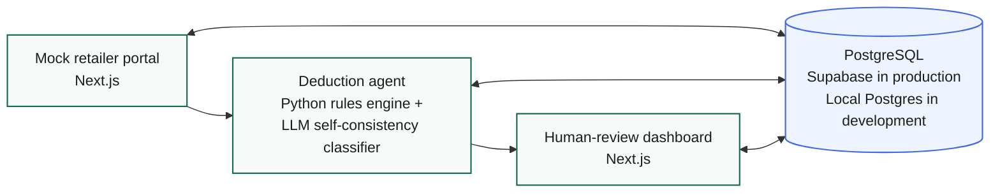

<div align="center">

# DeductionDesk

### AI-assisted deduction resolution for consumer packaged goods finance teams

[](https://deductiondesk-dashboard.vercel.app)
[-146C4E?style=for-the-badge)](eval/reports/combined_summary.json)


</div>

## Contents

- [The problem](#the-problem)
- [Live applications](#live-applications)
- [Architecture](#architecture)
- [What this demonstrates](#what-this-demonstrates)
- [Results](#results)
- [Honest limitations](#honest-limitations)
- [How to run locally](#how-to-run-locally)
- [Tech stack and job alignment](#tech-stack-and-job-alignment)

## The problem

Consumer packaged goods companies routinely receive less money than they invoiced because retailers subtract shortages, damages, pricing differences, promotions, and compliance fees from payments. Finance teams then have to reconstruct what happened across purchase orders, invoices, delivery records, and retailer notes before deciding whether to accept each deduction or dispute it. **DeductionDesk turns that fragmented investigation into a traceable workflow:** deterministic cases are handled by policy rules, ambiguous cases are escalated to an AI classifier, and the highest-value uncertain decisions are presented to a human reviewer with the underlying evidence.

## Live applications

| Application | Link | Access |
|---|---|---|
| **Supplier portal** | [Open the mock retailer portal](https://deductiondesk-portal.vercel.app) | `supplier_demo` / `glimpse2026` |
| **Review dashboard** | [Open the human-review queue](https://deductiondesk-dashboard.vercel.app) | No login required |
| **GitHub repository** | [Placeholder repository link](https://github.com/your-username/deductiondesk) | Replace before publishing |

## Architecture



The portal is the retailer-facing source and dispute-filing surface. The agent gathers evidence, resolves deterministic cases with rules, and sends ambiguous cases through three independent LLM judgments. The dashboard exposes the remaining decisions to accounting reviewers. PostgreSQL is the shared system of record for evidence, decisions, reviews, disputes, and evaluation data.

## What this demonstrates

- **Rules-first routing** — 64.9% of cases resolve deterministically; only 35.1% are escalated to the LLM.
- **Self-consistency confidence** — confidence is the three-call agreement rate, not a model's self-reported certainty score.
- **Calibration as an evaluated property** — confidence is compared with actual accuracy by bucket and rendered as a reproducible chart.
- **Adversarial portal-drift testing** — three mutated API scenarios test whether integration changes are detected instead of silently corrupting decisions.
- **End-to-end dispute operations** — the system generates an evidence-backed packet, files it through the portal, updates deduction state, and preserves an audit trail.
- **Human-in-the-loop review** — unresolved cases are ranked by claimed amount and model uncertainty so reviewers see the largest financial exposure first.

### Confidence calibration


### Document extraction pipeline (hybrid rules/LLM pattern)

> [!NOTE]
> **Separate Pipeline & Evaluation:** This benchmark evaluates the remittance document-ingestion subsystem (`agent/document_extractor.py`), which is completely separate from the core 750-case deduction-classification pipeline (98.27% blended / 90.93% baseline). It was evaluated on a focused 25-document synthetic remittance sample (13 clean tabular PDFs, 12 hard unstructured narrative memos) using local Ollama (`qwen2.5:3b-instruct`) for the LLM fallback path.

The ingestion engine applies the same two-tier architectural design—deterministic parsing first, escalating to an LLM only when ambiguity or layout breakdown is detected:

- **Non-LLM-only baseline:** Achieves **100.0% exact-match (13/13)** across all four fields on clean, tabular retailer documents (Walmart, Target, Costco, Kroger). However, it drops to **0.0% exact-match (0/12)** on hard, unstructured debit memos because without table grids, `pdfplumber` cannot extract structured rows, causing the regex fallback to naively capture the gross invoice billing figure instead of the true deduction claim.
- **Hybrid fallback recovery:** When non-LLM parsing detects missing fields or multiple conflicting dollar figures, the pipeline escalates only those cases to an LLM fallback. This recovers hard-tier exact-match accuracy from **0.0% to 58.3% (7/12)**, achieving:
  - **PO Number:** 91.7% (11/12)
  - **Invoice Number:** 91.7% (11/12)
  - **Claimed Amount:** 66.7% (8/12)
  - **Deduction Type:** 100.0% (12/12)
- **Zero unnecessary LLM calls:** Clean documents never triggered the LLM (0/13, 0.0%), preserving compute and staying 100% deterministic on structured files. Overall blended accuracy across the 25 documents reached **80.0% (20/25)**.

This demonstrates the same rules-first, LLM-escalation architecture pattern applied to a second, independent problem (document extraction vs. deduction validation), confirming the design choice generalizes rather than being a one-off.

## Results

Current results reflect a **blended multi-provider evaluation** across the 750-deduction dataset: **98.27% overall accuracy**. Among the 263 ambiguous cases escalated to an LLM, 230 deductions were reclassified using cloud-hosted Groq (`qwen/qwen3.8-27b`) while the remaining 33 deductions reflect the original local Ollama (`qwen2.5:3b-instruct`) baseline run from November 1st.

| Evaluation measure | Result | What it means |
|---|---:|---|
| Overall blended accuracy against ground truth | **98.27%** | 737 of 750 final verdicts matched the generated truth labels (blended across rules, Groq, and Ollama). |
| Blended LLM-only accuracy | **95.06%** | 250 of 263 ambiguous cases resolved correctly across both LLM cohorts. |
| Calibration gap | **-5.22 pts (under-confident)** | Reported confidence (93.05%) tracks safely below actual accuracy (98.27%). |
| Portal-drift resilience | **3 / 3 pass** | All adversarial scenarios failed safely with explicit schema exception handling. |
| Rules-engine unit tests | **8 / 8 pass** | Deterministic policy behavior passes the complete unit-test suite. |

### LLM Cohort Breakdown (Groq vs. Ollama)

Because the reclassification run was stopped before processing all 263 cases (see [Limitations](#honest-limitations)), the LLM-evaluated subset consists of two distinct cohorts:

| LLM Cohort | Model & Provider | Evaluated Deductions | Correct Verdicts | Accuracy | Operational Status |
|---|---|---:|---:|---:|---|
| **Groq-reclassified cohort** | `qwen/qwen3.8-27b` via Groq API | 230 | 230 | **100.00%** | Full 3-vote self-consistency re-run under Groq API. |
| **Legacy Ollama cohort** | `qwen2.5:3b-instruct` via local Ollama | 33 | 20 | **60.61%** | Unprocessed cases retained from the original Nov 1st run. |
| **Total / Blended LLM** | *Blended (Groq + Ollama)* | **263** | **250** | **95.06%** | Blended operational metric, not a single-model benchmark. |

<details>
<summary><strong>Expand the full evaluation breakdown</strong></summary>

### By deduction type

| Type | N | Accuracy | Invalid precision | Invalid recall | Invalid F1 |
|---|---:|---:|---:|---:|---:|
| Compliance | 113 | 97.35% | 100.00% | 91.18% | 95.38% |
| Damage | 53 | 100.00% | 100.00% | 100.00% | 100.00% |
| Pricing | 113 | 98.23% | 96.97% | 100.00% | 98.46% |
| Promotional | 220 | 98.64% | 97.90% | 100.00% | 98.94% |
| Shortage | 251 | 98.01% | 96.77% | 100.00% | 98.36% |

### By decision method

| Method | N | Accuracy | Invalid precision | Invalid recall | Invalid F1 |
|---|---:|---:|---:|---:|---:|
| LLM (blended) | 263 | 95.06% | 93.24% | 97.87% | 95.50% |
| Rules | 487 | 100.00% | 100.00% | 100.00% | 100.00% |

### Calibration buckets

| Confidence bucket | N | Mean confidence | Actual accuracy | Gap |
|---|---:|---:|---:|---:|
| 0.6–0.7 | 2 | 66.67% | 100.00% | −33.33 pts |
| 0.8–0.9 | 261 | 85.00% | 95.02% | −10.02 pts |
| 0.9–1.0 | 487 | 97.47% | 100.00% | −2.53 pts |

The overall confidence was 93.05% against 98.27% accuracy: **5.22 percentage points under-confident**. Source artifacts live in [`eval/reports/`](eval/reports/).

</details>

## Honest limitations

<details>
<summary><strong>Limitations — read before judging the accuracy numbers</strong></summary>

- **The LLM accuracy is a blended multi-provider result, not a single-model benchmark.** During a full reclassification run using Groq (`qwen/qwen3.8-27b`), Groq's free-tier token-per-minute (TPM) limit caused escalating backoff delays (wait times scaling from seconds to over 6 minutes per case). After 230 of the 263 LLM cases completed, the run was stopped to avoid excessive wait times. The remaining 33 cases were left in their original local Ollama (`qwen2.5:3b-instruct`) state from the November 1st baseline rather than reprocessed. Consequently, the **95.06% LLM-only accuracy** figure is NOT from a single consistent model—it blends a 100.00% cohort (230/230 on Groq) with a 60.61% cohort (20/33 on Ollama). All 13 remaining errors across the entire 750-case dataset stem entirely from the un-reprocessed Ollama cohort. This must be read as an operational, mixed-state snapshot rather than a controlled single-model evaluation.
- **The data is synthetic.** All 750 deductions are Faker-generated. No real retailer, supplier, invoice, or remittance data was used.
- **The LLM is meaningfully less accurate than the rules engine.** On the un-reprocessed baseline, LLM-only accuracy was 74.14%, compared with 100% for rules-resolved cases. Rules-first routing limits this exposure; it does not erase it.
- **A correct verdict can contain incorrect reasoning.** In prior local model testing, audits occasionally found cases where a model reached the correct boolean verdict despite citing flawed arithmetic or misinterpreting text. While Groq's reasoning in spot checks was strictly faithful to underlying database facts, this remains an inherent risk of generative evaluation that confidence scores cannot fully eliminate.
- **A ground-truth generation bug was found and fixed.** The generator and agent initially used inconsistent compliance-deduction allowance thresholds, which made some evaluation labels wrong. Finding and root-causing that mismatch is evidence that the evaluation process caught a real defect—not a reason to pretend the first labels were reliable.
- **Drift resilience mostly means detection, not recovery.** For two of three scenarios, passing means the agent fails clearly and safely rather than automatically adapting to the changed response.
- **This is a focused demo, not a production system.** It was built and evaluated over roughly one week. Production use would require real-data validation, stronger access controls and secrets management, monitoring, retry and reconciliation workflows, provider failover, and broader reasoning-quality evaluation.

</details>

## How to run locally

<details>
<summary><strong>Expand setup and commands</strong></summary>

### Prerequisites

Install Python, Node.js, PostgreSQL, and [Ollama](https://ollama.com). From `deduction-desk/`:

```bash
createdb deductiondesk

python -m venv .venv
source .venv/bin/activate
pip install -r requirements.txt -r agent/requirements.txt

cp .env.example .env
cp agent/.env.example agent/.env

(cd portal && npm install)
(cd dashboard && npm install)

ollama pull qwen2.5:3b-instruct
```

The default development database is `postgresql://localhost:5432/deductiondesk`. Change the copied environment files if your local connection differs.

### 1. Seed and validate the database

```bash
python -m generator.seed
python -m generator.validate
```

Seeding recreates the project tables and generates the 750-case dataset.

### 2. Start the mock retailer portal

In a second terminal:

```bash
cd portal
npm run dev
```

The portal runs at [http://localhost:3000](http://localhost:3000).

### 3. Start the review dashboard

In a third terminal:

```bash
cd dashboard
npm run dev
```

The dashboard runs at [http://localhost:3001](http://localhost:3001).

### 4. Run the agent pipeline

With PostgreSQL, Ollama, and the portal running, return to the project root with the Python environment activated:

```bash
python -m agent.main
```

To generate and file eligible dispute packets after classification:

```bash
python -m agent.main --file-disputes
```

### 5. Run the evaluation suite

```bash
python -m eval.run_all
pytest tests/test_rules_engine.py
```

Reports and the calibration chart are written to `eval/reports/`.

</details>

## Tech stack and job alignment

| Job-posting technology | How DeductionDesk uses it |
|---|---|
| **Python** | Data generation, deterministic policy rules, LLM classification, self-consistency scoring, packet construction, filing, and evaluation. |
| **Next.js** | Two deployed applications: the mock retailer portal and internal human-review dashboard, including production API routes. |
| **PostgreSQL** | Shared relational system of record for evidence, decisions, reviews, disputes, and ground truth—local Postgres in development and Supabase Postgres in production. |
| **Ollama** | Reproducible local LLM inference without sending records to an external model provider. Model access is configuration-driven, so the pipeline can swap to a hosted LLM API with a single provider/endpoint configuration change. |

Supporting tools include React, TypeScript, `psycopg2`, Pydantic, Faker, Jinja, Matplotlib, and `pytest`.
